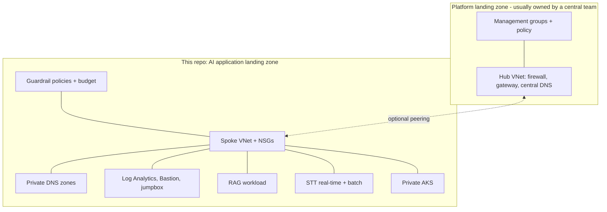

# ai-landing-zone-lab

[](https://github.com/goosain-platform-lab/ai-landing-zone-lab/actions/workflows/ci.yml)

An **Azure AI application landing zone** in Terraform: a governed, private spoke that hosts these AI workloads:

- **RAG chatbot**: Azure AI Search, Azure AI Services (chat and embedding models), Cosmos DB, and a front end with orchestrator and ingestion Function Apps. Infrastructure only, with placeholder apps. Module in this repo.
- **Real-time speech-to-text and translation**, from [terraform-azurerm-ai-stt](https://github.com/goosain-platform-lab/terraform-azurerm-ai-stt) at a pinned tag.
- **Speech batch pipeline** (Service Bus, Function App, SQL, Azure OpenAI), from [terraform-azurerm-ai-stt-batch](https://github.com/goosain-platform-lab/terraform-azurerm-ai-stt-batch) at a pinned tag.
- **Private AKS cluster** (Entra RBAC, workload identity, Cilium, Flux GitOps), from [terraform-azurerm-aks](https://github.com/goosain-platform-lab/terraform-azurerm-aks) at a pinned tag.

The whole thing is **secretless**. Deployment uses OIDC, and every app reaches every service with a managed identity and RBAC. Key auth is disabled on Speech, Translator, AI Services, Search, Cosmos DB, Service Bus, Storage, SQL and Application Insights.

## What this demonstrates

- **Landing-zone layers:** governance (13 Azure Policy guardrails, including AKS and in-cluster Kubernetes rules, and a budget), connectivity (spoke VNet, NSGs, optional hub peering), private DNS (created here or reused from a hub) and management (central Log Analytics, Bastion, an Entra-joined jumpbox).
- **Workload composition:** one module in this repo (RAG) and three external modules pinned by tag (speech real-time, speech batch and AKS).
- **Secretless and private:** OIDC deployment, managed identities with least-privilege RBAC, 28 private endpoints, and public access off on every data service.
- **CI quality gates:** `terraform validate` with both external modules pulled at their release tags, plus tflint and Checkov.

**Status:** validated in CI; not deployed, to avoid running costs.

## Where this fits in an Azure landing zone



| Layer | What it contains | File |
|---|---|---|
| Governance | 13 built-in policy guardrails at subscription scope (Audit by default) and a monthly budget | `platform-governance.tf` |
| Connectivity | /24 spoke, 5 subnets, NSGs, optional hub peering (spoke side) | `platform-network.tf` |
| DNS | 13 private DNS zones, or reuse the hub's zones via `existing_private_dns_zone_ids` | `platform-dns.tf` |
| Management | Central Log Analytics, Bastion, Windows jumpbox (Entra sign-in, auto-shutdown) | `platform-management.tf` |
| Workloads | RAG (`modules/rag`); STT real-time, STT batch and AKS (versioned external modules) | `workloads.tf` |

### Guardrail policies

Allowed locations · storage: no shared keys · storage: no public access · AI Services: key access disabled · AI Services: restricted network · Key Vault: RBAC model · Key Vault: no public access · Service Bus: local auth disabled · App Service: HTTPS only · Function apps: HTTPS only · AKS: private cluster · AKS: local accounts disabled · Kubernetes: no privilege escalation (enforced in-cluster).

All 13 are compliant by design, so you can switch `policy_effect` to `Deny` once the first deploy is clean. The two AKS cluster checks only support Audit, so they stay on Audit.

## Naming

`<type>-<workload>-<environment>-<region>`, for example:

| Resource group | Contents |
|---|---|
| `rg-ai-network-lab-zan` | `vnet-ai-lab-zan`, NSGs, private DNS zones, `bas-ai-lab-zan` |
| `rg-ai-shared-lab-zan` | `log-ai-lab-zan`, `vm-ai-jump-lab-zan` |
| `rg-rag-lab-zan` | `srch-rag-lab-zan`, `cosmos-rag-lab-zan`, `ais-rag-lab-sdc`, `app-rag-web-lab-zan`, `func-rag-orch-lab-zan`, `func-rag-ing-lab-zan`, `kv-rag-lab-zan` |
| `rg-aks-lab-zan` | `aks-apps-lab-zan`, `crappslabzan`, `kv-apps-lab-zan` (nodes in `rg-apps-nodes-lab-zan`) |
| `rg-stt-lab-zan` | Real-time: `spch-stt-lab-zan`, `trsl-stt-lab-zan`, `app-stt-api-lab-zan`, `kv-stt-lab-zan`. Batch: `func-stt-batch-lab-zan`, `sbns-stt-batch-lab-zan`, `sql-stt-batch-lab-zan` |

Storage accounts drop the hyphens (`stragdocslabzan`). Set `unique_suffix` if a global name is taken.

## Default SKUs (production-grade)

| Workload | Resource | SKU |
|---|---|---|
| RAG | AI Search | standard2, 1 replica, 1 partition, semantic ranker (free) |
| RAG | App Service plan (Linux) | P1v3, shared by front end + 2 Function Apps |
| RAG | AI Services | S0 in `swedencentral`; chat `gpt-5.1` and `text-embedding-3-large` |
| RAG | Cosmos DB | 2 containers, autoscale up to 1,000 RU/s each |
| STT real-time | Speech / Translator | S0 / S1 |
| STT real-time + batch | App Service plan (Windows), shared | B1 |
| STT batch | Service Bus / SQL database | Premium 1 MU / S0 |
| AKS | Cluster / node pools / registry | Standard tier / system 3-5 + user 2-10 x `Standard_D4ds_v5` / Premium |
| Shared | Bastion / jumpbox | Standard / Standard_D4s_v5 (Windows Server 2022) |

Check that the default models are available in `ai_location` before applying, and change `chat_deployment` / `embedding_deployment` in `modules/rag` if they aren't.

## Setup

### 1. One-time Azure setup

**Makes changes.** Run in Windows PowerShell on your machine after `az login`:

```powershell
.\scripts\bootstrap-azure.ps1 -SubscriptionId <subscription-id> `
  -HcpOrganization <your-hcp-org> -Workspaces ai-landing-zone-lab -IncludePolicyRole
```

The script creates:
- an app registration with HCP Terraform **federated credentials**, and no client secret;
- the subscription roles **Contributor**, **Role Based Access Control Administrator** and **Resource Policy Contributor** (the last one is for the guardrails);
- an **ai-lab-admins** group with you in it, used as the batch SQL admin and for jumpbox sign-in.

It prints everything you need for step 2.

### 2. HCP Terraform workspace

1. Create workspace `ai-landing-zone-lab` (VCS-driven, this repo, working directory = repo root).
2. **Environment variables:** `TFC_AZURE_PROVIDER_AUTH=true`, `TFC_AZURE_RUN_CLIENT_ID`, `ARM_SUBSCRIPTION_ID`, `ARM_TENANT_ID`.
3. **Terraform variables:** from [`terraform.tfvars.example`](terraform.tfvars.example). At minimum set `sql_entra_admin`, `jumpbox_admin_principal_id` and `aks_admin_group_object_ids` (HCL), plus `budget_amount` and `budget_contact_emails`.

### 3. Deploy

The STT and AKS modules are fetched from their own repos at `v0.1.0`. Then plan and apply in HCP Terraform.

To leave a workload out, set `rag_enabled`, `stt_enabled`, `stt_batch_enabled` or `aks_enabled` to `false`.

### 4. Post-deployment

| Step | Why | How |
|---|---|---|
| Grant the batch identity access to SQL | SQL users can't be created through ARM | Run the T-SQL in the [batch README](https://github.com/goosain-platform-lab/terraform-azurerm-ai-stt-batch#post-deployment-grant-the-identity-access-to-sql) |
| Store the orchestrator function key | The one secret left: the front end calls the orchestrator with a function key | See below |
| Approve Search shared private links (only if you add indexers) | Search indexers need to reach private storage | `az search shared-private-link-resource create`, then approve on the storage account |
| Deploy app code | Function Apps are private | From the jumpbox or a VNet-connected runner |

**Orchestrator key, stored as a Key Vault reference:**

1. Give yourself **Key Vault Secrets Officer** on `kv-rag-lab-zan`.
2. From the jumpbox (the vault is private):
   ```powershell
   $key = az functionapp keys list -g rg-rag-lab-zan -n func-rag-orch-lab-zan --query functionKeys.default -o tsv
   az keyvault secret set --vault-name kv-rag-lab-zan -n orchestrator-function-key --value $key
   ```
3. The front end already has `ORCHESTRATOR_FUNCTION_KEY = @Microsoft.KeyVault(VaultName=kv-rag-lab-zan;SecretName=orchestrator-function-key)`. Restart it and the value resolves with its managed identity.

To remove this last secret, protect the orchestrator with App Service authentication (Entra ID) and have the front end call it with a token from its managed identity.

### 5. Reach the private apps

1. Connect through Bastion's native client with your Entra account (needs the Standard SKU):
   ```powershell
   $vm = az vm show -g rg-ai-shared-lab-zan -n vm-ai-jump-lab-zan --query id -o tsv
   az network bastion rdp --name bas-ai-lab-zan --resource-group rg-ai-network-lab-zan --target-resource-id $vm --enable-mfa
   ```
2. Browse to the front end's `*.azurewebsites.net` host name (`terraform output rag`) from the jumpbox. Private DNS resolves it to the private endpoint.

The jumpbox shuts down at 19:00 every day (`jumpbox_auto_shutdown_time`). Its local admin password exists only in Terraform state and is never output. With the low-cost profile (Bastion Basic has no native client), connect in the portal with a local account: reset its password first with `az vm user update`.

## Connecting to a real hub

| Variable | Effect |
|---|---|
| `hub_virtual_network_id` | Creates the spoke-to-hub peering. The hub owner creates hub-to-spoke. |
| `use_hub_gateway = true` | Routes on-premises traffic through the hub VPN/ExpressRoute gateway |
| `existing_private_dns_zone_ids` | Uses the hub's zones instead of creating them here. The hub team links them to this spoke, usually through policy. |

## Cost

These defaults bill continuously and are the main costs: **AI Search standard2**, **Service Bus Premium**, **Bastion Standard**, the **D4s_v5 jumpbox** (auto-shutdown helps), the **P1v3** plan, 28 **private endpoints** and the **AKS node pools**. Model tokens are pay-per-use. For short lab sessions:

- apply [`low-cost.tfvars.example`](low-cost.tfvars.example) (Search basic, P0v3, Service Bus Standard, smaller jumpbox, Bastion Basic);
- set a `budget_amount`;
- run `terraform destroy` when you're done.

## Repo layout

```
platform-*.tf          landing zone (governance, network, DNS, management)
workloads.tf           RAG + STT wired into the platform
modules/rag/           RAG workload module
scripts/               one-time Azure bootstrap (OIDC, roles, admin group)
.github/workflows/     fmt, validate, tflint, Trivy (no Azure credentials needed)
```
